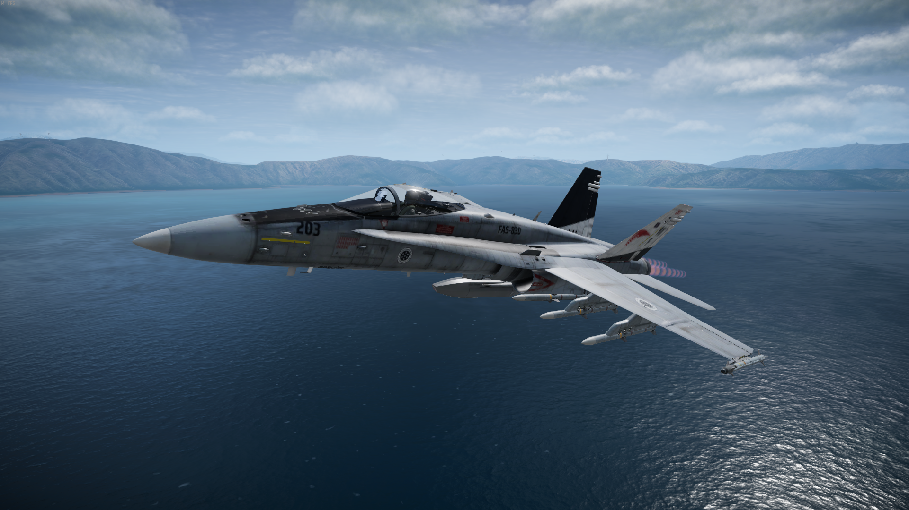
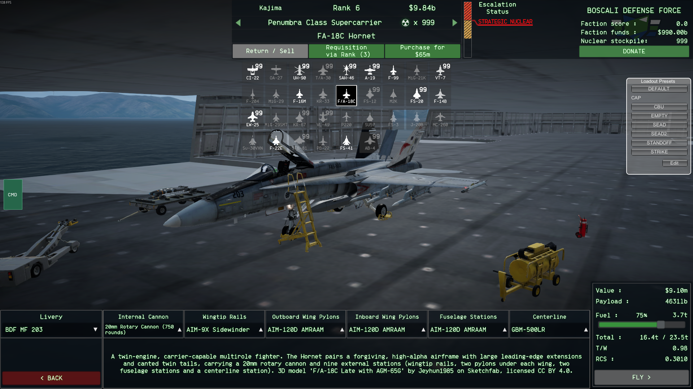

# F/A-18C Hornet for Nuclear Option

A US Navy F/A-18C Hornet for Nuclear Option. It is built with the Blueprinter framework, plus a small BepInEx plugin for the flight systems that Blueprinter can't do on its own. The flight model is tuned to real-world F/A-18C figures from the NATOPS flight manuals (NFM-000, NFM-200 and NFM-210), except fuel burn, which is slightly generous.

**Current release:** `FA-18C Hornet_0.7.0.nobp` + `FA18C.HornetSystems.dll` 0.7.0 (extended update)

**Download:** grab the files from the [latest release](https://github.com/SirKajima/NO-FA-18C-Hornet/releases/latest), or from the [`release/`](release/) folder of this repo.

---

## Installation

You need BepInEx and the Blueprinter mod already installed.

1. Delete any older `FA-18C Hornet_*.nobp` from your `BepInEx\plugins` folder (and its subfolders). Two versions at once will conflict.
2. Copy both files from the `release/` folder (or the release download) into `Nuclear Option\BepInEx\plugins\` (a subfolder such as `plugins\FA18C\` is fine):
   - `FA-18C Hornet_0.7.0.nobp`
   - `FA18C.HornetSystems.dll` 0.7.0 (keep only one copy; the 0.7.0 jet and plugin go together)
3. Start the game. The Hornet appears in the hangar aircraft list.
4. Optional, with [Aryx's FS-41 Eclipse](https://github.com/Aryx3D/Aryx-s-FS-41-Eclipse) mod: the Hornet can spawn on the **Penumbra Class Supercarrier** and the **Helion Class Carrier** and use their catapults. Put `release/FA18C.catapults` in `BepInEx\plugins\com.nikkorap.blueprinter\addons\aryx.fs41\`. In multiplayer **every player** needs this file, not just the host: each player's own game runs their catapult launch. See [Compatibility](#compatibility-with-other-mods-optional-soft-dependencies) for how to launch and trap.
5. Optional, with [kingwixly's **Multi-Missile**](https://github.com/kingwixly/Multi-Missile/) mod (1.5.0): its missiles and bombs appear on the Hornet's stations automatically. Nothing extra to install. Without Multi-Missile the Hornet works as before.

The jet flies without the `.dll`, but you lose the features marked **[plugin]** below. In multiplayer, every player flying the Hornet should have the same files.

---

## Compatibility with other mods (optional, soft dependencies)

Neither mod below is required. The Hornet has no hard reference to them: if one is missing, the game simply loads without that feature (Blueprinter logs a harmless "not found" line and skips it).

### Aryx's FS-41 Eclipse: Penumbra Class Supercarrier (and Helion Class Carrier)

[Aryx's FS-41 Eclipse](https://github.com/Aryx3D/Aryx-s-FS-41-Eclipse) adds the **Penumbra Class Supercarrier** and the **Helion Class Carrier**, with working catapults and arresting wires.

**Setup**
1. Install Aryx's FS-41 Eclipse (and Blueprinter, which it needs).
2. Copy `release/FA18C.catapults` from this repo into `Nuclear Option\BepInEx\plugins\com.nikkorap.blueprinter\addons\aryx.fs41\`. This file tells Aryx's catapult where the Hornet's nose wheel is. Without it the Hornet can still spawn on the carrier, but the catapult won't grab it.
3. **Multiplayer: every player flying the Hornet needs `FA18C.catapults`**, not just the host. Each player's catapult launch runs in their own game.

**Spawning on the carrier**
- The Hornet is added to the carrier's fixed-wing hangars: Penumbra `Hangar_F_01`, `Hangar_F_02`, `Hangar_F_R_01` and Helion `Hangar_F`.
- In a mission with a Penumbra (or Helion) on your side, pick the carrier as your spawn point and choose the Hornet from the aircraft list.

**Catapult launch**
1. Taxi slowly to a catapult. The HUD shows the catapult overlay and **Clutch distance**. Line the nose wheel up on the catapult track.
2. **Slow down** and **hold the wheel brake**. The catapult engages ("Catapult engaged – Aligning aircraft") and pulls the jet into position.
3. Wait for "Catapult spooling up", then **"Catapult ready – Throttle up"**: go to full throttle (afterburner recommended).
4. After the countdown the catapult fires. It releases at about **165 kt** with about **4.5 g**. Pulling the throttle back before launch cancels it ("Throttle up to resume").

**Arrested landing (tail hook)**
- The tail hook is built in: it **lowers by itself** on approach (below about 190 kt, between 100 and 400 ft, descending). You don't need a key.
- Gear down, flaps out, and fly a stable approach at about **130–140 kt (on-speed angle of attack about 8°)** onto the angled deck. Aim for the wires and don't flare; carrier landings are meant to be firm.
- The hook catches a wire and stops the jet. The plugin's carrier-strength nose strut and reduced nose slam keep the gear intact. The hook goes back up once you've stopped.
- If you miss the wires (a bolter), go to full power and fly off the angled deck for another try.

### kingwixly's Multi-Missile

[kingwixly's Multi-Missile](https://github.com/kingwixly/Multi-Missile/) adds real-world missiles and bombs, including the **AIM-120D AMRAAM**, **AIM-9X / AIM-9M Sidewinder** and **JDAMs** (500, 1,000 and 2,000 lb).

**Setup:** install Multi-Missile (it needs Blueprinter). That's all; there's nothing extra to copy. Its weapons appear in the Hornet's loadout menu on the stations that already carry the same kind of store.

**Using them:** in the hangar, click a station in the loadout bar at the bottom (for example *Wingtip Rails*) and pick the Multi-Missile weapon from its list. Fire them like any other weapon. The AIM-120D is radar-guided (lock and fire), the AIM-9s are heat-seekers, and JDAMs are GPS bombs dropped on a target you've selected.

| Station | Multi-Missile weapons |
|---|---|
| Wingtip Rails | Wingtip AIM-9X, AIM-9M, AIM-9Z, IRIS-T and AIM-120D |
| Fuselage Stations | Single AIM-120D, AIM-9X / 9M / 9Z, IRIS-T, Meteor, R-27ER, K-30, SACM |
| Outboard and Inboard Wing Pylons | **AIM-120D** (single, double), **AIM-9X / AIM-9M** (single, double, triple), AIM-9Z, IRIS-T, Meteor, R-27ER, K-30, SACM racks; **JDAM** 500 lb (1–3), 1,000 lb (1–2), 2,000 lb; GBU-39 and GBU-53 quads; SLAM-ER, Storm Shadow, Brimstone; Exocet, ATMACA, Zircon |
| Centerline | Same as the wing pylons, plus the SLAM-ER centreline mount |

- Multi-Missile's rack and missile shapes are its own. The plugin stops them from damaging the Hornet when it spawns, even where a rack touches a neighbouring part (setting `MountSelfCollisionFix`, on by default).
- **Multiplayer:** every player needs Multi-Missile and the same Hornet files.

---

## Make your own livery (Livery Paint Kit)

The **Livery Paint Kit** is a separate download on the [releases page](https://github.com/SirKajima/NO-FA-18C-Hornet/releases/latest) (`LiveryPaintKit_FA18C.zip`). It has everything needed to paint a custom livery for the FA-18C Hornet:
- `FA18C_PaintKit.fbx`: exterior model with only the paintable surfaces, using the same UV layout as the mod. Import it into Substance Painter or Blender.
- `FA18C_PaintKit_WithReference.fbx`: the same model plus the canopy glass and the parts that keep their own textures, in plain grey.
- `FA18C_PaintKit.blend`: Blender file with the base texture already connected.
- `FA18C_Livery_Base.png`: the default 4096 x 4096 livery texture to paint over.
- UV guides: wireframe, a colour map showing which side of the jet each texture area belongs to, and the lines drawn over the base texture.
- `README.md` with step-by-step instructions, and `LiveryBuilder.cs` (see below).

Liveries are built and uploaded the official way, as in the Steam guide [How to Build and Publish a Livery](https://steamcommunity.com/sharedfiles/filedetails/?id=3656861098). Paint one colour texture, build it with the Nuclear Option Livery Project in Unity, test it from `AppData\LocalLow\Shockfront\NuclearOption\Skins`, and upload it from **Main Menu > Workshop > Upload > Aircraft Livery**.

The one extra step is that the livery builder doesn't list modded jets. Use the kit's `LiveryBuilder.cs`, or add `"FA-18C Hornet"` to the `Aircraft` list in `Assets/Scripts/Editor/LiveryBuilder.cs`, and pick **FA-18C Hornet** as the aircraft. Suggested glossiness is 0.40. Players need this mod installed to see the livery.

---

## Highlights

### Aircraft and visuals
- Detailed 3D model with working moving parts:
  - stabilators, ailerons, trailing-edge flaps and twin rudders, each on its real hinge line
  - leading-edge flaps that droop with angle of attack and at low speed
  - canopy that opens when you get out
  - airbrake with an animated actuator piston
  - landing gear with doors
- Liveries: **Navy Gray** and **MF 203**, available in both **BDF** and **PALA** versions, with custom emblems.
- Vapour from the leading-edge root extensions (the LEX) at high angle of attack, plus wingtip vortices and correctly placed navigation and landing lights.
- **[plugin]** Rudder toe-in, as on the real jet. With the flaps down, both rudders turn 30° inward on the ground and help lift the nose on takeoff. In the air they follow angle of attack: neutral at about 8° and 15° outward at 11°.
- **Working tail hook:** the whole hook, arm and hook point, lowers by itself on approach (below about 190 kt, 100–400 ft, descending), catches carrier arresting wires, and goes back up when you stop. **[plugin]** The game's AI and airbase list also treat the Hornet as hook-equipped.
- **Pilot** sits properly in the ejection seat, at the real eye position.
- **[plugin] Clear targeting camera:** your own jet is hidden from the targeting camera, so wings, fuselage and stores never block the view of the target. The landing camera still shows the jet.
- Weapons: internal 20 mm cannon, wingtip rails, two pylons under each wing, two fuselage stations and a centreline station.

### Flight model
Built from real F/A-18C data (NATOPS manuals, NASA tests), then tuned for Nuclear Option. **[plugin]** Two profiles in the config: `GameFeel` (default) and `NATOPS` (strict real-world limits and thrust).

**GameFeel (default):** War Thunder-style handling. The Hornet's strengths are nose-pointing, the strong override pull and low-speed control. Its weaknesses are acceleration and top speed below an F-16's, and roll cut with air-to-ground stores on the wings.
- **g:** 8 g with Stability Assist on and 10 g with it off, at any weight. Push −3 g (on) or −5 g (off).
- **Pitch** builds g faster.
- **Thrust** is about 8 % higher below 15,000 ft, so acceleration and the takeoff roll are a little quicker. Clean top speed on the deck is about Mach 1.1.

The rest of this section describes the shared model; the g-limit and speed lines are for the `NATOPS` profile.
- **Pitch:** smooth, Hornet-like response; holds a 7.5 g fly-by-wire limit.
- **Roll:** about 180–190°/s with a combat load (measured in game).
- **Flaps:** scheduled automatically below 250 kt. **[plugin]** They give real full-flap lift: approach at about 130 kt, 8.1° angle of attack, at a light landing weight.
- **Takeoff:** the nose comes up at about 140–145 kt with a typical combat load (about 16.8 t).
- **Airbrake:** strength in line with the real jet.
- **Fuel:** about 42 min at full military power and about 11 min in full afterburner down low (measured in game). **[plugin]** Fuel flow now drops with altitude like the real engines, so high-altitude cruise and afterburner last about 2–3× longer than before.
- **[plugin] g limits:**
  - 7.5 g limit up to 32,357 lb, lower when heavier, never below 5.5 g (the real FCS rule). At 16.8 t it is about 6.5 g.
  - −3 g push limit at all weights.
  - G-limit override (**Stability Assist off**): +33 %, up to 10 g at any speed, like the real "paddle switch". At 16.8 t it is about 8.7 g.
  - Up to 1 g less when slowing down through Mach 1 (not below 5 g).
  - Roll-rate limiter: maximum roll rate cut by about a third with air-to-ground stores or tanks on the wing pylons.
- **[plugin] Speed and altitude:** drag and engine thrust fitted to the NATOPS acceleration and level-flight charts. Model figures for a CAP-type load: top speed about Mach 1.05 at sea level, 1.36 at 10,000 ft, 1.5 at 20,000 ft, 1.7 at 30,000 ft and 1.75 at 35,000–40,000 ft. At 30,000 ft it gets from Mach 0.65 to 1.3 in about 80 s (real: 75 s). These are model figures, not yet measured in game.

### Carrier operations
- Catapult launches and arrested landings on Aryx's carriers (see Installation, step 4).
- **[plugin]** Carrier-strength nose gear strut, so wire arrests and firm deck landings don't break it.
- **[plugin]** Less nose slam after catching a wire (the real wire pulls 2 m below the centre of gravity; half of that nose-down jolt is removed).
- **[plugin]** Wheel contact safety net: if a wheel's ground check ever misses the deck, it checks again from higher up (and on both nose wheels), so the jet doesn't sink into the deck.

### Damage
- **Break-apart:** the airframe is split into separate parts, so shot-off or crash-damaged wings, tails and control surfaces visibly come off, with their paint.
- **Damage display:** the HUD diagram now highlights the parts that are actually damaged, including the intakes and weapon bays.
- **[plugin] Over-g failure:** pull too hard and a wing tears off.
  - At about 12.5 g, or below about −5 g.
  - Lower when heavy: about 10.9 g at 16.8 t.

### Plugin settings
Edit `BepInEx\config\fa18c.hornet.systems.cfg` (created after the first launch):

| Setting | What it does |
|---|---|
| `FlightProfile` | `GameFeel` (default, War Thunder-style) or `NATOPS` (strict real-world limits and thrust) |
| `LowAltitudeThrustBoost` | GameFeel only: extra thrust below 15,000 ft (default 0.08 = +8 %) |
| `PitchResponse` | GameFeel only: how quickly g builds (default 1.2) |
| `TailHook` | Working tail hook on/off |
| `ClearTargetingCamera` | Hide your own jet from the targeting camera |
| `ArrestPitchRelief` | How much of the wire's nose-down jolt is removed: 0 = real, 1 = none (default 0.5) |
| `CarrierNoseGear` | Stiffer carrier-rated nose gear strut |
| `GearContactProbe` | Wheel contact safety net on decks |
| `GearDiagnostics` | Writes a log line when the safety net steps in (for bug reports) |
| `TransonicModel` | Thrust loss with altitude, extra thrust at high Mach, transonic drag |
| `FcsGLimits` | Weight-based g limits, −3 g push limit, 10 g override at all speeds |
| `OverGStructuralFailure` | Wing tears off when over-stressed |
| `RudderToeIn` | Rudder toe-in/toe-out with flaps down, and the takeoff nose-up help |
| `FlapLift` | Real full-flap lift in the air (approach speed) |
| `RollRateLimiter` | Roll rate cut with air-to-ground stores or tanks on the wing pylons |
| `MountSelfCollisionFix` | Weapons hung on the jet (any mod's, e.g. Multi-Missile) never collide with the jet's own parts, so they can't damage it at spawn (default on) |
| `MountCollisionLog` | Writes a log line for every weapon mount the fix is applied to (for bug reports, default off) |
| `GunMuzzleFix` | Muzzle flash and smoke at the gun port on top of the nose (default on) |
| `CockpitClipFix` | Keeps the cockpit view from cutting away the instrument panel after an airfield spawn (default on) |
| `FuelModel` | `AltitudeOnly` (default): fuel drops with altitude, never above the old rate. `Realistic`: also burns more at low-level high speed. `Off`: stock game fuel |

---

## Changelog (0.4 → 0.7)

### 0.7.0 (plugin 0.7.0): extended update
- **Livery Paint Kit (new, separate download):** exterior FBX models, base texture, UV guides and instructions for making your own liveries; see [Make your own livery](#make-your-own-livery-livery-paint-kit).
- **[plugin] Gun:** the muzzle flash and smoke now appear at the gun port on top of the nose, at the front of the anti-glare panel (before they showed 0.7 m further forward). The bullets leave from the same place as before.
- **Afterburner deeper in the nozzles:** the nozzle glow now sits deep in the tailpipe at the turbine face instead of at the nozzle exit, and the flame starts 0.55 m inside the nozzle (same length behind the jet).
- **Canopy glass** is clear from the cockpit (no more milky haze); it looks the same from outside.
- **Two engines.** The Hornet had a single game engine with two flames (it came from the single-engine FS-12). Now each F404 is its own engine with its own nozzle, flame, sound and heat haze, at half the old thrust and fuel flow each, so total thrust, fuel burn and IR signature are unchanged, and the plugin's thrust and fuel models work as before. The electrical generators charge at the same total rate. Losing an engine now costs half the thrust. The damage display shows ENGINE 1 / ENGINE 2 fires.
- **Fuselage stations moved 0.30 m aft** (and 2 cm out), so missile noses sit about 0.2 m behind the intake lips instead of poking out in front. The stations stay parallel with the fuselage, so neither end of the missile sinks into it.
- **[plugin] Cockpit camera on airfield spawns:** fixed the view that sometimes showed the nose through a missing instrument panel. Cause: a game bug sets the camera's near clip plane to 1 m when the spawn menu closes, which cuts away everything closer than 1 m (the panel and HUD frame). The plugin holds it at 0.2 m in the cockpit. Same fix in the F-14 plugin.
- **Gear:** the nose leg now finishes retracting with the main legs, so the main doors run one clean cycle.

### 0.6.4 (plugin 0.6.4)
- **[plugin] Weapons no longer damage the jet at spawn.** Some Multi-Missile racks have solid collision shapes that reach into a neighbouring part of the Hornet (single missiles on the fuselage stations and centreline, the Exocet on the wing pylons). The game pushed the parts apart when the jet spawned, which damaged them. Weapons hung on the Hornet now ignore collisions with its own parts; they still hit the ground, other aircraft and bullets normally. Works for any mod's weapons (setting `MountSelfCollisionFix`, on by default). Multi-Missile weapons need this plugin version.
- **Multi-Missile compatibility** (optional; needs kingwixly's Multi-Missile 1.5.0). Its weapons go on the stations that already carry the same kind of store:
  - **Wingtip rails:** Multi-Missile's wingtip AIM-9X, AIM-9M, AIM-9Z, IRIS-T and AIM-120D.
  - **Fuselage stations:** single air-to-air missiles (AIM-9X/9M/9Z, IRIS-T, K-30, AIM-120D, Meteor, R-27ER, SACM).
  - **Wing pylons (inboard and outboard) and centreline:** all external air-to-air racks (single to triple, SACM quad); JDAMs (500, 1000 and 2000 lb), GBU-39 and GBU-53 quads; SLAM-ER, Storm Shadow and Brimstone; anti-ship Exocet, ATMACA and Zircon. The centreline also gets the SLAM-ER centreline mount.
  - Not added: internal-bay mounts (no bays), mounts made for one specific jet, the nuclear Zircon, and the helicopter Brimstone rotary.

### 0.6.3 (plugin 0.6.3)
- **Pilot** moved forward out of the seat back and headrest, sitting a little more upright to match the seat. The cockpit camera moves with him, about 30 cm closer to the HUD, near the real eye position.
- **Targeting camera:** your own jet no longer blocks the view of the target from any angle.

### 0.6.2 (plugin 0.6.2)
- **Tail hook:** the black hook point now swings down with the arm.
- **Arrested landings:** no more nose face-plant or broken nose gear after catching a wire (stiffer nose strut, less nose-down jolt from the wire).
- **Deck taxiing:** safety net for the nose wheel sinking into the deck and losing steering.

### 0.6.1
- **Aryx carriers:** the Hornet can spawn in the fixed-wing hangars of the Penumbra Class Supercarrier (`Aryx_Supercarrier1`: Hangar_F_01, Hangar_F_02, Hangar_F_R_01) and the Helion Class Carrier (`Aryx_LightCATOBAR1`: Hangar_F). Both come with Aryx's FS-41 mod.
- **Catapults:** a catapult config `FA18C.catapults` for those carriers. It locks onto the bottom of the nose wheel, releases at about 165 kt and accelerates at 4.5 g.

### 0.6.0 (plugin 0.6.0)
- **Working tail hook.** The hook from the 3D model is now a separate moving part that deploys automatically on approach and catches arresting wires.
- **GameFeel flight profile (default).**
  - 8 g with Stability Assist on and 10 g off, at any weight.
  - Push −3 g (on) or −5 g (off).
  - Quicker pitch response.
  - About 8 % more thrust below 15,000 ft: quicker acceleration and a slightly shorter takeoff roll.
  - The wing breaks at about 11.5 g or −7.7 g.
  - The real-world 0.5.5 behaviour is still available with `FlightProfile = NATOPS`.
- **Roll limiter** with air-to-ground stores or tanks on the wing pylons kept as a Hornet weakness.

### Plugin 0.5.5 (NATOPS performance review)
- **Speed at altitude:** drag and thrust refitted to the NATOPS charts. The jet no longer stalls out near Mach 1 between 10,000 and 35,000 ft: at 30,000 ft, Mach 1.3 takes about 80 s instead of about 4 minutes. It's no longer unrealistically fast above 45,000 ft.
- **Fuel:** burn now drops with altitude and speed, like the real engines. High-altitude range is about 2–3× longer. Low-level burn is unchanged.
- **Flaps:** real full-flap lift in the air. Approach about 130 kt instead of 145 kt.
- **Rudders:** NATOPS toe-in/toe-out schedule by angle of attack while the flaps are down.
- **g limits:** −3 g push limit fixed at all weights; never below 5.5 g when very heavy; transonic g reduction.
- **Roll-rate limiter** with air-to-ground stores or tanks on the wing pylons.

### 0.5.1 (plugin 0.5.2 → 0.5.4)
- **Rudder toe-in** on the ground with gear and flaps down. It fixes the late takeoff rotation that the bigger flaps from 0.5.0 caused. The nose now comes up at about 140–145 kt instead of about 165 kt. The rudders are set to 30° and return to neutral right after lift-off.
- **g limits now scale with weight** above 32,357 lb: the 7.5 g limit, the 10 g override, the −3 g push limit, and the wing-failure point.
- **Gear cleanup:** removed the floating black bits around the nose gear and inside the main gear doors.
- **Slats:** the low-speed slat droop now follows the same speed schedule as the flaps.
- **Plugin fix (0.5.3):** the plugin couldn't find the gear, rudders, engines or wings, because the game splits the jet into separate parts at spawn. As a result, the toe-in, the thrust model and the over-g wing failure only work properly from plugin 0.5.3 onwards.

### 0.5.0
- **Roll rate** raised to the real value, about 200°/s clean.
- **Flaps:** now give real lift, so the approach is flown at about 145 kt and 8° angle of attack. They deploy automatically below 250 kt.
- **Airbrake** reduced to half strength (it was too strong).
- **Break-apart:** the airframe is split per part, so damage visibly tears off wings, tails and control surfaces.
- **Damage HUD fixed:** the part images were the wrong size or mirrored. They're redrawn from the jet's real outline, and the intakes and weapon bays are added.
- **New BepInEx plugin (`FA18C.HornetSystems.dll`):**
  - −3 g push limit
  - G-limit override at all speeds
  - thrust and drag changes for realistic acceleration at altitude
  - over-g wing failure

### 0.4.8
- **Leading-edge flaps** move: they droop with angle of attack (up to 34°) and to 12° at low speed.
- **LEX vapour** at high angle of attack.
- **Fuel:** non-afterburner burn raised to near real (about 42 min at full military power on internal fuel).

### 0.4.7
- Fixed a crash while loading mods that was caused by the 0.4.6 build.

### 0.4.6
- **Takeoff:** rotation fixed; the jet now flies off at a realistic 150–160 kt.
- **Lift:** the leading-edge root extensions (the LEX) now add more lift at high angle of attack.
- **Drag and engines:** drag and engine thrust at altitude tuned for realistic top speeds.

### 0.4.5
- **Pitch:** retuned to NASA flight-test data; removes the stiff, snappy feel.
- **g limits:** 7.5 g fly-by-wire limit, and the 10 g G-limit override with Stability Assist off.
- **Fuel:** afterburner fuel burn set to the real value.

### 0.4.3 / 0.4.4
- **Liveries:** the livery menu now works. Added the MF 203 livery in BDF and PALA versions, with emblems in 0.4.4. Navy Gray fixed.

### 0.4.2
- **Ailerons:** sit flush with the wing at rest.
- **Pylons and racks:** realigned.
- **Main gear:** the new model's main gear couldn't deploy convincingly, so it went back to the earlier legs with the new wheels.
- **Nose gear:** missing parts restored; the nose wheel wobble fixed.

### 0.4.1
- **Canopy:** frame fixed.
- **Hinges:** the hinge brackets now move with the flaps and ailerons.
- **Pylons, airbrake, lights:** pylon racks fixed, airbrake actuator piston added, lights repositioned.
- **Gear:** new-model gear parts added.

### 0.4.0
- **New 3D model:** replaced the original placeholder model.
- **Canopy and airbrake:** a working canopy and an airbrake.
- **Control surfaces:** all moved to their real hinge lines.
- **Hardpoints:** repositioned to the new pylons.

---

## Known limitations
- Made for third-person flying. The cockpit HUD, screens and instruments don't work yet.
- The main gear legs are older, simpler meshes. The wheels are from the new model.
- LEX vapour looks like round puffs rather than thin streaks.
- Carrier operations are tested on the Penumbra supercarrier only; the Helion carrier should work the same but is untested.

---

## Credits
- 3D model: "F/A-18C Late with AGM-65G" by **Jeyhun1985** on Sketchfab, licensed **CC BY 4.0**. The model was modified for this mod (see [CREDITS.md](CREDITS.md)).
- Main gear legs and one material: "McDonnell Douglas F/A-18C Hornet 3D Model" by **Rhine_Lab_Muelsyse** on Sketchfab, licensed **CC BY 4.0** (the model used before 0.4.0).
- Livery lettering: Saira font family (SIL Open Font License).
- Built with the **Blueprinter** framework for Nuclear Option, plus BepInEx and Harmony.

---

## Source code and licence

This mod is open source. The plugin source, the Unity (Blueprinter-Editor) mod folder and the editor tooling are in this repo; see [docs/BUILDING.md](docs/BUILDING.md). Code and project files: [MIT](LICENSE). 3D model and textures: CC BY 4.0, see [CREDITS.md](CREDITS.md).
